<div align="center">

# SurfMeter

### Your browsing. A little clearer.

Your browser time, in the menu bar and a detailed Mac app.

[Download Alpha 1](https://github.com/vishwajayawickrama/surf-meter/releases/tag/v0.1.1-alpha.1) · [Install the DMG](docs/distribution.md) · [Setup guide](docs/setup.md) · [Functional audit](docs/qa-audit.md) · [Try the Mac app](#try-the-native-development-build) · [Explore the prototype](#try-the-first-look) · [Screenshots](#a-closer-look) · [Roadmap](#whats-next)

</div>

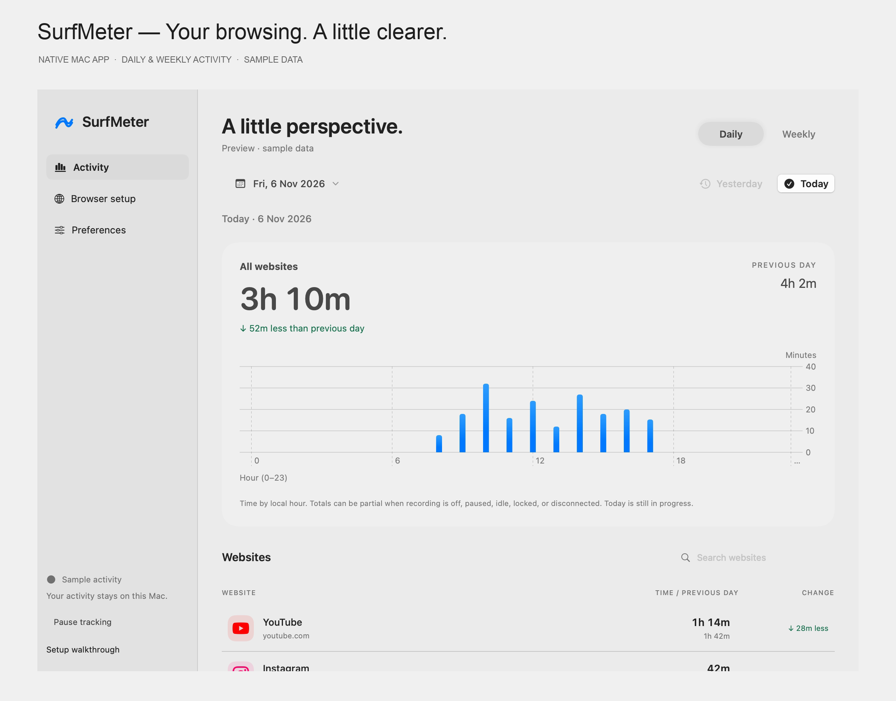

> **Native development build available.** SurfMeter 0.1.1 Alpha 1 includes a resizable desktop window and first-run setup walkthrough alongside its SwiftUI menu bar dashboard, Chrome tracking engine, and local aggregate storage. The Apple Silicon DMG is an ad hoc signed, unnotarized development prerelease. Real-browser accuracy/privacy certification, Safari, and signed distribution are still in progress. The screenshots and GIF state tours show the current native development UI with labeled sample data. They may include improvements made after the downloadable Alpha 1 build.

## Open the bigger picture

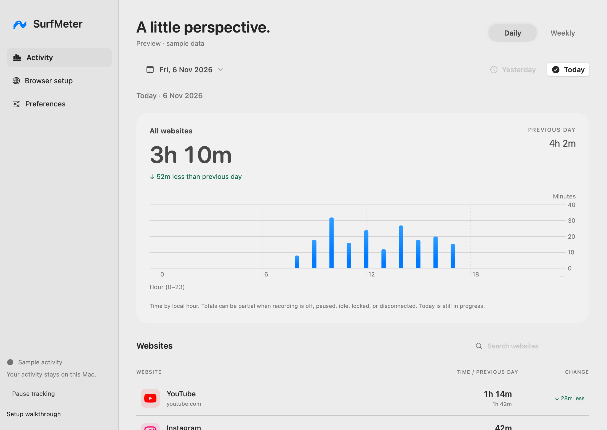

Browse dates, search websites, and select a platform to explore its chart. Daily has a dedicated Yesterday button; Weekly shows seven calendar days. Close the window to keep SurfMeter in your menu bar, then reopen it whenever you need more detail.

**[Download the Alpha 1 DMG](https://github.com/vishwajayawickrama/surf-meter/releases/tag/v0.1.1-alpha.1)** · Apple Silicon · [Installation and first-run walkthrough](docs/distribution.md). Includes the app, Chrome extension and offline illustrated guide. No developer tools needed to run it. Chrome setup is still manual; Safari and production signing/notarization remain pending.

## Know where the hours went

A few minutes on YouTube. A quick scroll through Instagram. Another Reddit tab. SurfMeter is being built to make those little moments visible, right where you can check them: your menu bar.

- **Today, at a glance.** See time per platform, with yesterday’s total beside it. Green means less time; red means more. Arrows make the change clear, too.
- **Yesterday, one click away.** A dedicated button inside Daily lets you revisit the full day without losing your place.
- **Your week, in perspective.** A seven-day chart, platform totals, and daily averages show the bigger picture. Today’s partial day is clearly labeled.
- **Look a little closer.** Open a platform to explore its hourly or daily breakdown. Details follow the period you’re viewing.
- **Make room for your preferences.** Explore light and dark appearances, pause/resume, and website exclusions in the preview.

## Take a look around

<p align="center">
  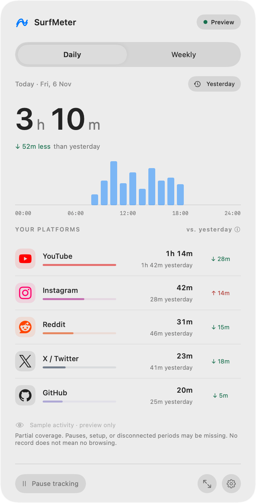
  &nbsp;
  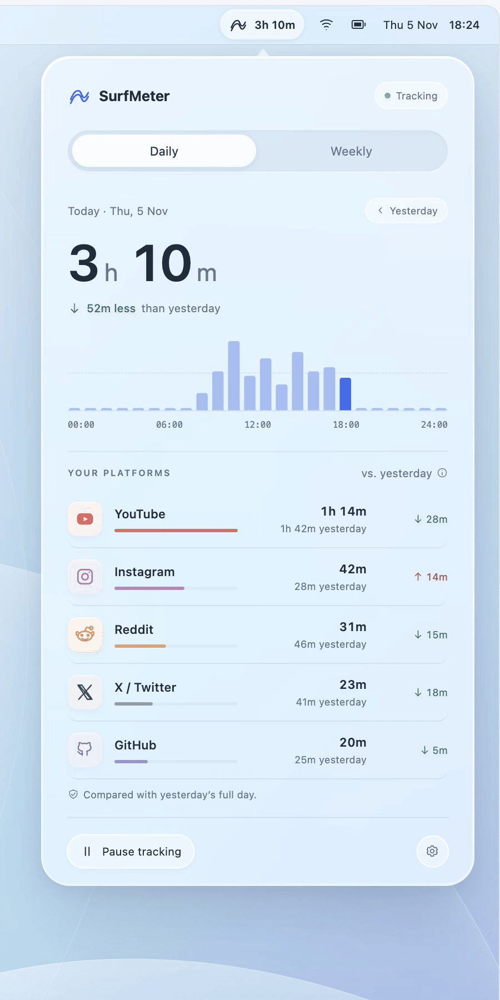
</p>

*Current native UI state tours: activity (left) and appearances (right). Each state holds for three seconds; these are not continuous recordings. Original 2× renders use sample data. Prefer still images? Open the screenshots below.*

## A closer look

<details>
<summary><strong>Open the screenshot gallery</strong></summary>
<br>

| Daily | Weekly |
| :---: | :---: |
| [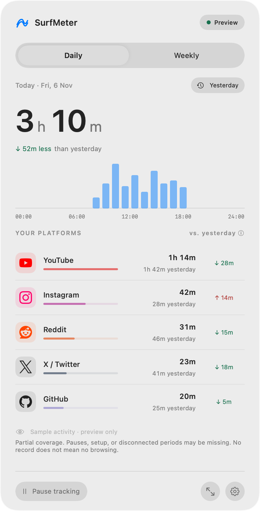](https://raw.githubusercontent.com/vishwajayawickrama/surf-meter/main/docs/media/daily-2x.png) | [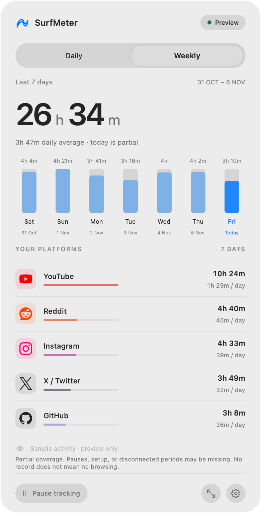](https://raw.githubusercontent.com/vishwajayawickrama/surf-meter/main/docs/media/weekly-2x.png) |

| Yesterday | Dark preferences |
| :---: | :---: |
| [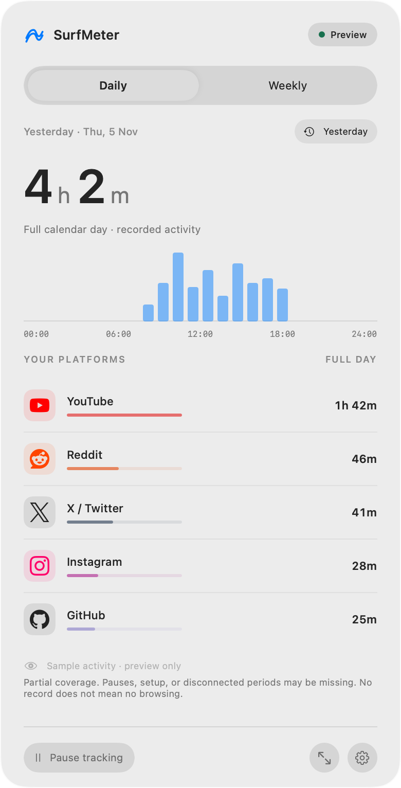](https://raw.githubusercontent.com/vishwajayawickrama/surf-meter/main/docs/media/yesterday-2x.png) | [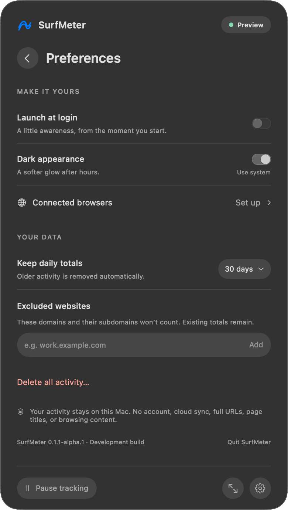](https://raw.githubusercontent.com/vishwajayawickrama/surf-meter/main/docs/media/preferences-dark-2x.png) |

| Desktop · dark | Calendar · dark |
| :---: | :---: |
| [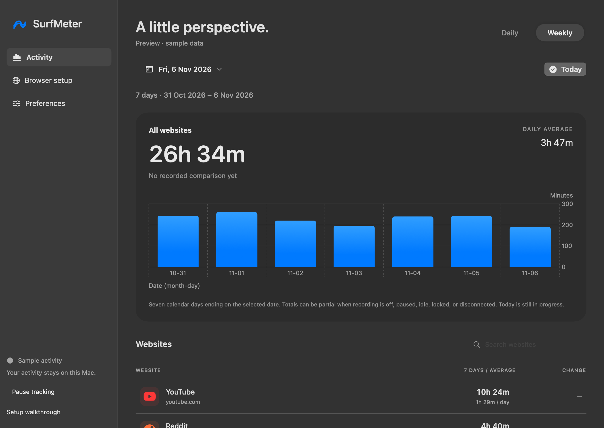](docs/media/desktop/desktop-weekly-dark-2x.png) | [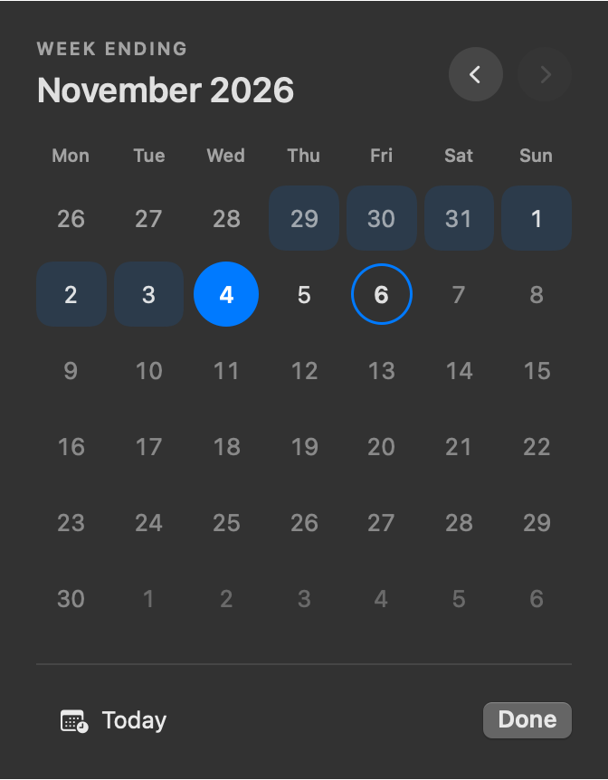](docs/media/desktop/calendar-weekly-dark-2x.png) |

Click any screenshot to view it at full size.

</details>

## Made for a quieter kind of awareness

The visual direction takes inspiration from Apple’s Liquid Glass: a floating translucent panel, softly lit edges, and simple controls that leave the numbers easy to read. The native app follows macOS light and dark appearances, with native sidebar materials and keyboard navigation. The browser prototype remains available separately.

The native development app uses active-tab timing and local aggregate storage, excludes private-window activity, and needs no account. Validation status and remaining gates are documented in the functional audit.

## Try the native development build

Build the Chrome extension, then the Mac app:

```sh
cd extensions/chrome
npm ci
npm run build
cd ../..
./scripts/build-native.sh
open .build/SurfMeter.app
```

Requires macOS 14+, Swift 6, and Node/npm to build. Open **Browser setup** in the app, load its bundled Chrome extension, paste the extension ID, connect, and enable recording. Safari is not enabled yet. See the [annotated setup guide](docs/setup.md) and [tested capabilities and remaining gates](docs/validation.md).

The native app includes Daily/Weekly views, Yesterday, website details, green/red comparisons, pause/resume, exclusions, retention, confirmed deletion, and appearance preferences. Activity stays in a local aggregate store; there is no backend or account. Build a self-contained development DMG and ZIP with `./scripts/package-app.sh`; see [distribution](docs/distribution.md) for the installation walkthrough and signing limitations.

<p align="center">
  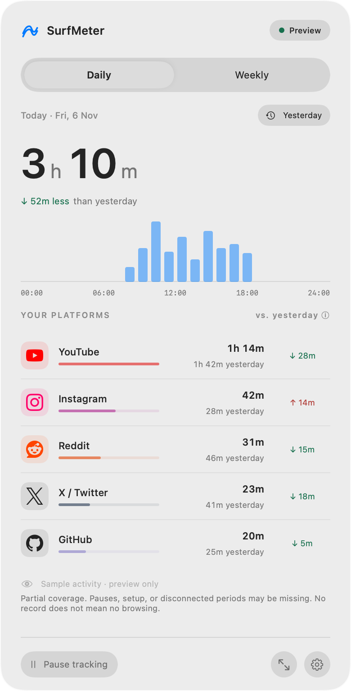
  &nbsp;
  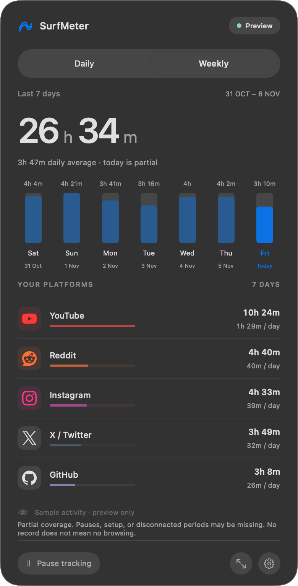
</p>

*Native SwiftUI previews at 2× resolution. Sample activity, with transparency disabled for reproducible captures. Live system materials appear in the running Mac app.*

<!-- resource-results:start -->
## Measured resource use

30.0-minute native development-build run on Apple M4, 16 GiB RAM, macOS 27.2 (2026-11-06). CPU is percent of **one logical core**; memory uses decimal MB. Chrome processes are excluded.

| Workload | App + helper mean CPU | Peak sampled app + helper RSS | Peak app + helper charged footprint |
| --- | ---: | ---: | ---: |
| Installed · normal Chrome use | 10.16% | 74.9 MB | 1,330.1 MB |
| Controlled active · synthetic | 5.44% | 95.4 MB | 116.8 MB |
| Controlled idle · unavailable | 3.74% | 96.5 MB | 116.5 MB |

The installed helper was already about 9.4 hours old at the start; controlled helpers were fresh.

Counter samples cover 1,799.999718 seconds of the nominal 30-minute run. A finalizer error was explicitly recovered; end-of-run database-size/accounting checks were not captured.

App bundle: **4.0 MB logical** (4.0 MB allocated file blocks); local activity data and the installed helper copy are separate.

**The CPU goal is not met in this run. Charged-memory growth needs investigation.** These are measured development-build results, not an optimized release claim.

[Method, plots, disk usage, raw results, and limitations](docs/performance.md).
<!-- resource-results:end -->

## Try the first look

You only need Python 3 and a browser. No packages, account, or build step.

```sh
git clone https://github.com/vishwajayawickrama/surf-meter.git
cd surf-meter
python3 -m http.server 5173 --bind 127.0.0.1 --directory prototype
```

Open **[localhost:5173](http://127.0.0.1:5173/)** and click around. Start with Daily, try Yesterday, then switch to Weekly. The left navigation opens Preferences and Browser setup; **Reset demo** restores the original sample data.

The browser connections, activity, and system settings are simulated. Preview preferences are stored in your browser’s local storage. The desktop frame and left navigation are design-review tools around the planned menu bar interface.

## What’s next

Try the [native development build](docs/development.md#build-the-native-app), or read the [current validation results](docs/validation.md). The native app now includes accounting, persistence, and the dashboard. README screenshots and GIF state tours now use the current native UI with sample activity.

Native implementation is organized into [five tasks](docs/implementation.md), with completion criteria and handoff notes for work across sessions.

- [ ] Native foundation and browser feasibility
- [ ] Accurate activity tracking engine
- [ ] Local storage and usage summaries
- [ ] Native UI and complete app integration
- [ ] Validation, packaging, and first release

Want to shape the next iteration? [Open an issue](https://github.com/vishwajayawickrama/surf-meter/issues) with feedback on the interface or how you’d use SurfMeter.

---

[Documentation](docs/README.md) · [Implementation](docs/implementation.md) · [Requirements](docs/srs.md) · [Technology stack and architecture](docs/architecture.md) · [Development guide](docs/development.md) · [Media and capture notes](docs/media/README.md)
