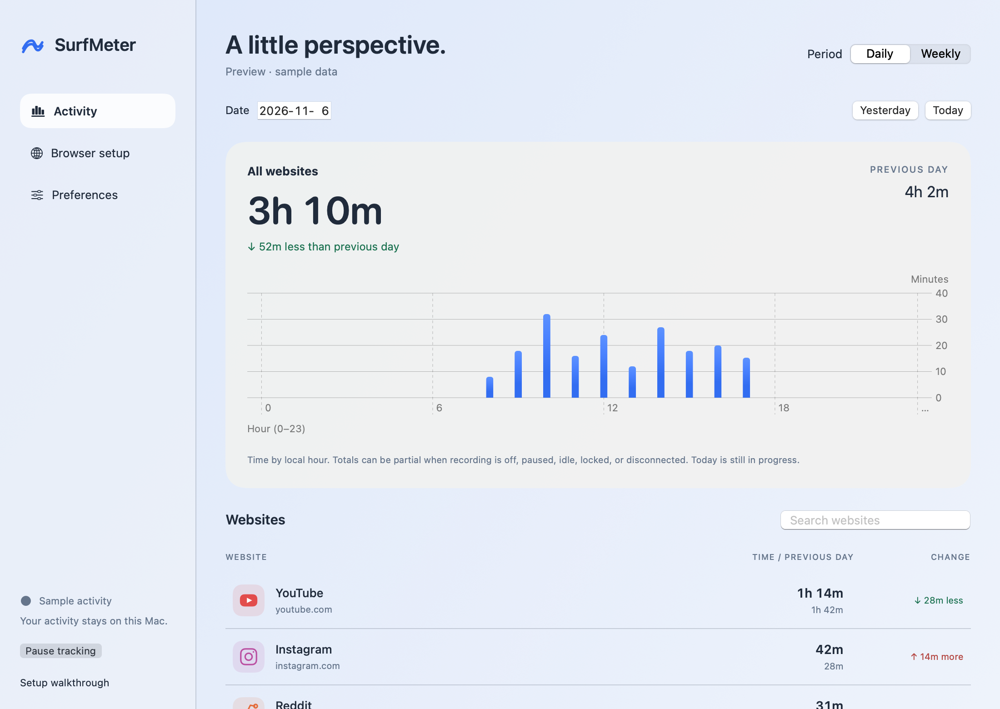

# SurfMeter — Desktop app and downloads

Updated: 2026-11-06 · Version 0.3.0 development

SurfMeter has two views of one recording session: a compact menu bar panel and a resizable Mac window. Both use the same `AppModel`, single-writer lease, local bridge and Core Data store. Opening a window does not start another recorder.

## Download and install

Download the Apple Silicon DMG and its SHA-256 checksum from [development releases](https://github.com/vishwajayawickrama/surf-meter/releases). This is an **ad hoc signed, unnotarized prerelease**, with outstanding browser and resource-usage validation. It is not a certified production release. The current binary is arm64; Intel users need a source build. macOS 14 is the deployment target; only the current development Mac has been exercised.

1. Open the DMG. Drag **SurfMeter.app** onto **Applications**.
2. Eject the image and open SurfMeter from Applications. Do this before loading the extension or registering its local helper. Quit the old copy before replacing an existing installation.
3. Follow the four-step walkthrough. Choose **Set up later** to explore with recording off.
4. Connect Chrome, then explicitly enable recording. Download users need Chrome, but do not need Swift, Xcode, Node, npm or Python.

The image includes **Start Here.html**, an offline illustrated installation guide. macOS may block this development build. Verify its source and consult [Apple's app-opening guidance](https://support.apple.com/guide/mac-help/open-a-mac-app-from-an-unknown-developer-mh40616/mac); do not disable Gatekeeper globally.

## First-run walkthrough

| Step | What to do | Preview |
| --- | --- | --- |
| Welcome | Read what is collected; Continue starts setup without enabling recording. | [Welcome screenshot](media/desktop/onboarding-1-light-2x.png) |
| Installation | Keep the app in Applications before connecting Chrome. A copy running from `/Volumes/` cannot continue past this step. | [Installation screenshot](media/desktop/onboarding-2-light-2x.png) |
| Browser | Reveal ChromeExtension, use Chrome's Load unpacked command, paste the ID, connect, and opt into recording. See [annotated Chrome instructions](setup.md#3-load-the-chrome-extension). | [Connection screenshot](media/desktop/onboarding-3-light-2x.png) |
| Preferences | Choose optional launch at login and system/light/dark appearance. Open SurfMeter completes the flow. | [Preferences screenshot](media/desktop/onboarding-4-light-2x.png) |

Use **Setup walkthrough** in the window sidebar to revisit it. Setup completion has a separate `UserDefaults` key; existing preference JSON does not change. Existing recording users skip the first-run sheet. Skipping setup never enables recording. Safari is explicitly unavailable.

## Two ways to open your activity

Open SurfMeter from Applications or click the menu panel's **expand** button to show the detailed window. Closing that window removes the Dock presence while keeping the menu bar app and recording services alive. Reopening from Finder restores the same window. Login launches and native-host launches stay in the background. Choose **Quit SurfMeter** in Preferences to stop the app.

The desktop has Daily and Weekly tabs, a date picker, Yesterday/Today shortcuts, a local-hour or seven-day chart, website search, and row selection to filter the chart. Weekly means seven calendar days ending on the selected date. Comparison uses the preceding day or preceding seven days. A missing baseline displays no comparison; green means less time and red means more. A seven-day average includes partial/unrecorded days, so it is descriptive rather than a complete-day estimate. Older dates can be empty because of retention.

[](media/desktop/desktop-daily-light-2x.png)

## Build the disk image

From a Mac checkout with the [build prerequisites](development.md):

```sh
(cd extensions/chrome && npm ci && npm run build)
SURFMETER_BUILD_CONFIGURATION=release ./scripts/build-native.sh
./scripts/package-app.sh
```

The version comes from `version.txt`. Packaging checks the bundle version, architecture, bundled extension and deep/strict code signature, then creates `.build/SurfMeter-0.3.0-arm64-development.dmg` (or `x86_64` on an Intel build), its `.sha256` file, and the existing development ZIP. The DMG contains the app, Applications shortcut, offline guide and setup images. `hdiutil verify` checks its integrity. Build and package operations never copy a user's database, preferences, native-host configuration or browser profile into the artifact.

To verify a downloaded checksum, run from the folder containing both files:

```sh
shasum -a 256 -c SurfMeter-0.3.0-arm64-development.dmg.sha256
```

## Before a production release

Developer ID signing and notarization remain a release gate. Apple's [Developer ID documentation](https://developer.apple.com/developer-id/) and [notarization workflow](https://developer.apple.com/documentation/security/notarizing-macos-software-before-distribution) describe signing with an Apple-issued identity, submitting with `notarytool`, and stapling the accepted ticket. The current scripts deliberately produce development artifacts and do not claim that workflow has run.

A production release also needs clean-user installation/upgrade tests, real-browser accuracy/privacy and lifecycle checks, supported OS/architecture testing, a smoother signed browser-extension distribution path, and the resource fixes/retest listed in [Performance](performance.md). The baseline benchmark describes the earlier 0.2 build; it is not a measurement of this desktop build. See [Validation](validation.md).
