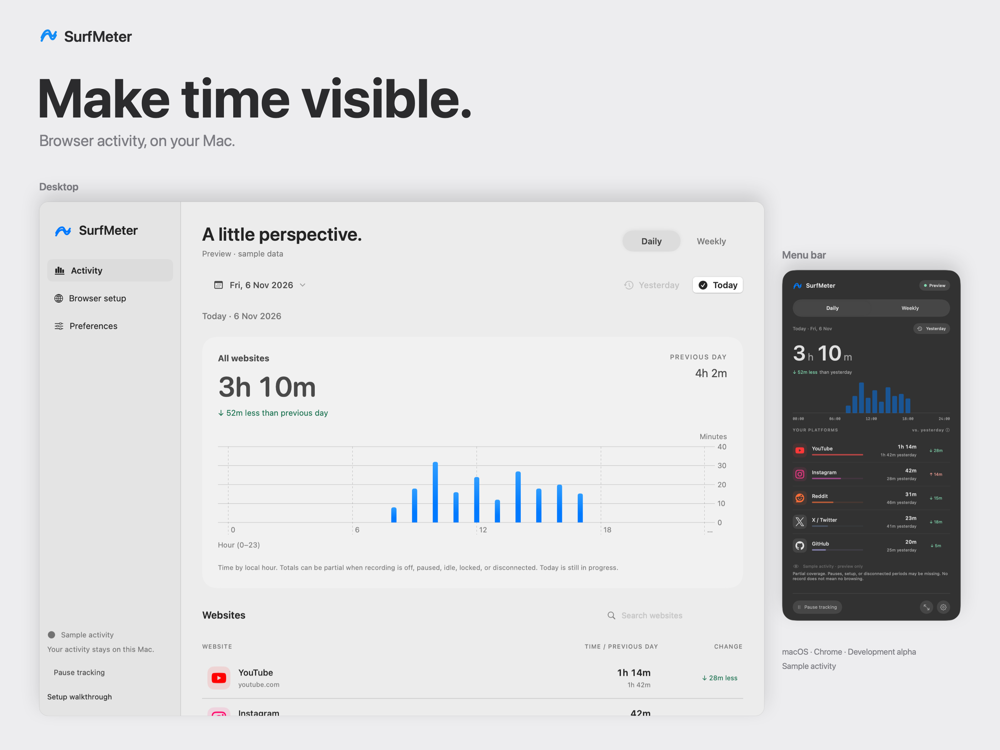

# README media

Refreshed on 2026-11-06 from the native app at source revision `127abbd`. All activity is labeled sample data; no recorded browser history is used. These images show the current development UI, which can be newer than the published Alpha 1 DMG.

## Current product visual

[](marketing/surf-meter-product-visual-v2.png)

The main README uses this 2800 × 2100 composition of original app renders and the app's exact wave mark. [Download PNG](marketing/surf-meter-product-visual-v2.png) · [Editable SVG](marketing/surf-meter-product-visual-v2.svg) · [Source and regeneration notes](marketing/README.md).

Regenerate it after refreshing its source screenshots:

```sh
swift -module-cache-path /private/tmp/surfmeter-swift-cache scripts/render-marketing-graphic.swift
```

## Assets

- `marketing/surf-meter-product-visual-v2.png`: current README hero showing the desktop and menu bar with minimal copy; editable SVG and original screenshot sources are alongside it.
- `cover-2x.png`: earlier 2400 × 1880 desktop cover, retained but no longer used as the README hero.
- `daily-2x.png`, `yesterday-2x.png`, `weekly-2x.png`, `daily-dark-2x.png`: current 780 × 1532 native menu layouts.
- `preferences-dark-2x.png`: current 780 × 1380 preferences layout.
- `activity-tour-2x.gif`: Daily, Yesterday, Weekly and weekly platform detail; 12 seconds.
- `appearance-tour-2x.gif`: Daily in light and dark; six seconds.
- `desktop/`: current desktop, calendar and onboarding renders in both appearances.
- `native/`: current menu layouts; icon galleries are maintained separately.

The GIFs hold each state for three seconds and loop indefinitely. They are state tours, not continuous screen recordings. Frames retain the original 2× resolution; shorter detail views are padded, never stretched. GIF palette optimization uses error-diffusion dithering; linked PNG stills preserve full color.

These are AppKit/SwiftUI layout renders. Offscreen capture omits parts of the live Liquid Glass compositor and does not reproduce desktop-dependent translucency or native window chrome. View the running app for those effects. They are not evidence of connected-browser accuracy.

## Rebuild

Build the current app, then render in isolated sample mode and compose the media:

```sh
SURFMETER_BUILD_CONFIGURATION=release ./scripts/build-native.sh
.build/SurfMeter.app/Contents/MacOS/SurfMeter --render-previews /private/tmp/surfmeter-readme-current
.build/SurfMeter.app/Contents/MacOS/SurfMeter --render-calendar /private/tmp/surfmeter-readme-current
python3 scripts/build-readme-media.py /private/tmp/surfmeter-readme-current
cp /private/tmp/surfmeter-readme-current/calendar-*-2x.png docs/media/desktop/
```

The composition script requires FFmpeg and the macOS system Arial font. It replaces the earlier desktop cover, menu stills, native/desktop/onboarding galleries and both GIFs. The current product hero is composed separately with the Swift renderer above. Calendar images are copied separately. Review output visually before committing. Historical audit evidence and annotated setup captures are kept separately and are not overwritten by this workflow.
