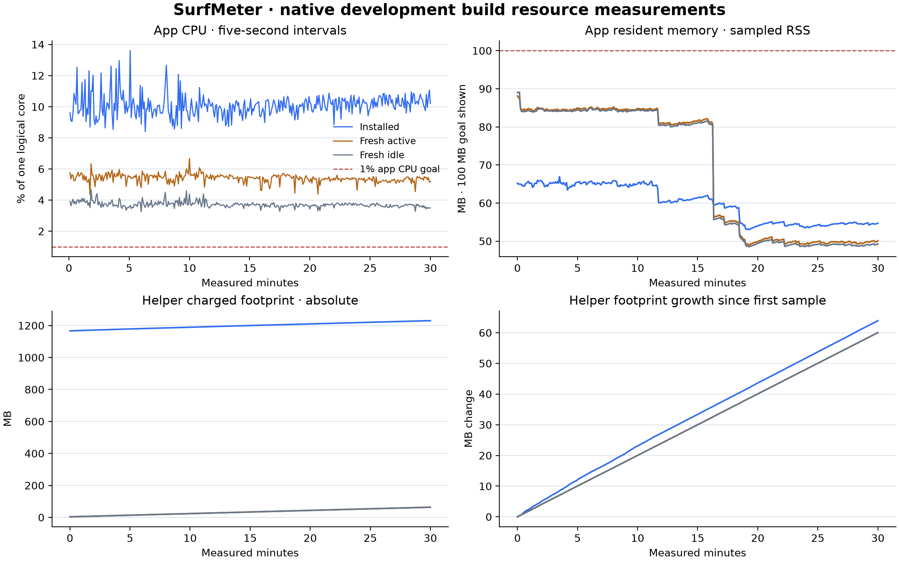

# Resource measurements

This report measures the native development build on one reference Mac. CPU, resident memory, charged memory footprint, and disk activity are reported separately. Results describe the measured build and workload; they are not release-wide guarantees.

<!-- resource-results:start -->
## Reference results · 2026-11-06

**Counter-window recovery:** the harness reached the final sample, then failed on a negative sleep caused by deadline rounding. The preserved span is 0.000282 seconds short of nominal. CPU/memory/kernel-I/O summaries are computed from the retained CSV, not invented. Database-size endpoints, post-run synthetic SQL totals, and the final process-event list were not captured and remain null. The original executed harness is archived with a matching SHA-256; the fixed harness passed a separate 35-second deadline/end-snapshot retest.

Measured 1799.999718 seconds after a 30-second warmup; samples every 5 seconds. Source baseline `08a8552`; the exact installed binary and harness hashes are in the exported summary. Reference hardware: Apple M4, 10 logical cores, 16 GiB RAM, macOS 27.2 (26B123).

| Scenario | App CPU mean / P95 | Helper CPU mean | App peak sampled RSS | Helper peak sampled RSS | Peak native charged footprint |
| --- | ---: | ---: | ---: | ---: | ---: |
| Installed · normal Chrome use | 10.09% / 11.23% | 0.078% | 66.9 MB | 11.6 MB | 1,330.1 MB |
| Controlled active · synthetic | 5.40% / 5.76% | 0.037% | 88.1 MB | 10.4 MB | 116.8 MB |
| Controlled idle · unavailable | 3.71% / 4.04% | 0.020% | 89.1 MB | 10.4 MB | 116.5 MB |

### Charged-memory growth

| Process / scenario | Start | End | Change | Linear trend |
| --- | ---: | ---: | ---: | ---: |
| Installed · normal Chrome use · app | 67.1 MB | 99.8 MB | 32.7 MB | 1.06 MB/min |
| Installed · normal Chrome use · helper | 1,166.4 MB | 1,230.3 MB | 63.9 MB | 2.10 MB/min |
| Controlled active · synthetic · app | 22.7 MB | 53.1 MB | 30.4 MB | 1.01 MB/min |
| Controlled active · synthetic · helper | 3.6 MB | 63.7 MB | 60.0 MB | 2.00 MB/min |
| Controlled idle · unavailable · app | 22.6 MB | 52.9 MB | 30.4 MB | 1.00 MB/min |
| Controlled idle · unavailable · helper | 3.5 MB | 63.5 MB | 60.0 MB | 2.00 MB/min |

The installed helper was already about **9.4 hours old** at measurement start. Its starting footprint did not accumulate entirely during this 30-minute run. Controlled helpers were newly launched before warmup.

### Disk and observer overhead

Installed app bundle: **4.0 MB logical**, **4.0 MB allocated file blocks**. Bundled helper/extension assets are included; shared OS frameworks and Chrome are not.

| Scenario | Kernel written bytes during run | Database files at start | Database files at end |
| --- | ---: | ---: | ---: |
| Installed · normal Chrome use | 1,769,472 | Not captured | Not captured |
| Controlled active · synthetic | 4,124,672 | Not captured | Not captured |
| Controlled idle · unavailable | 0 | Not captured | Not captured |

Observer overhead: 0.107% mean of one core; 23.0 MB peak sampled RSS. Observer work is excluded from app/helper totals.

Data quality: the final process-event list was not captured; 0 samples with wall/monotonic divergence over five seconds; 0 heartbeat cycles over 500 ms late. Post-run synthetic SQL totals were not captured; no accounting result is claimed from this resource run.

### Budget assessment

The CPU goal is not met in this run. Sampled installed-app RSS was below 100 MB in this run. Charged-memory growth needs investigation. This single development-build run does not establish a release-wide guarantee. Profile observed growth and repeat the benchmark after any fix.



[Vector plot](benchmarks/2026-11-06-m4/resource-usage.svg) · [Numeric samples](benchmarks/2026-11-06-m4/samples.csv) · [Machine-readable summary](benchmarks/2026-11-06-m4/summary.json)
<!-- resource-results:end -->

## Build comparability

All app workloads used the same installed app executable. A post-run [environment check](benchmarks/2026-11-06-m4/environment-check.json) found that the long-lived installed helper and the currently bundled helper copied into the controlled workloads were **not byte-identical**. Their hashes are published. Age, workload, and helper-build effects are therefore not isolated by this comparison; do not attribute every difference solely to process age.

The Chrome app bundle observed after the run was version 157.0.8103.38; the running browser's version was not independently captured. The measurement harness used Python 3.13.18. These are post-run metadata observations, not a claim of browser-version certification.

## Method

The harness is [measure-resources.py](../scripts/measure-resources.py). It observes the already-running installed app while running two independent copies of that same installed binary and its bundled native helper against disposable data:

| Scenario | Workload |
| --- | --- |
| Installed | User-directed normal Chrome browsing with recording already configured. The panel was requested closed; foreground activity and panel visibility are not automatically verified. |
| Controlled active | Fresh app/helper, one accepted active snapshot per second, cycling five synthetic platforms every 60 seconds. Native foreground and idle eligibility are explicitly simulated. |
| Controlled idle | Fresh app/helper, one accepted unavailable snapshot per second. This includes an idle bridge heartbeat rather than a disconnected process. |

All three scenarios target 1,800 measured seconds concurrently after a 30-second warmup. Kernel counters are sampled every five seconds, including measurement endpoints. The monitor records only resource counters, process counts/membership changes, app/build information, and aggregate file sizes. It never reads tab URLs, page contents, titles, browsing-domain records, or real database rows. Synthetic database queries validate only the disposable workloads.

The installed app and helper are observed without changing their preferences, restarting them, or clearing their data. Only the two temporary workloads are terminated and removed afterward. The installed helper may have been running substantially longer than the app; process age is reported so a long-lived process is not mistaken for a fresh 30-minute allocation.

### CPU

`proc_pid_rusage` supplies cumulative user/system CPU counters. The harness converts the platform's Mach time units using `mach_timebase_info`, then cross-checks the installed process against `ps TIME` before proceeding. This matters on Apple Silicon: interpreting Mach ticks as nanoseconds would substantially underreport CPU.

For each interval:

```text
CPU percent = 100 × delta(user CPU seconds + system CPU seconds) / elapsed monotonic seconds
```

100% means one logical core fully busy; percentages are not divided by the machine's core count. The run mean is time-weighted from cumulative deltas. P95 and maxima describe sampled intervals, not instantaneous spikes. Process replacement is recorded; work that occurs entirely between discovery samples cannot be recovered from these counters.

### Memory

- **Resident set size (RSS):** pages currently resident for the process. The SRS target is below 100 MB of resident memory for the app.
- **Charged footprint:** `ri_phys_footprint`, reported separately because compressed/nonresident accounted memory can make it much larger than RSS. It is not interchangeable with resident RAM.
- **Sampled peak:** the largest observed five-second reading after warmup. Launch transients and shorter spikes are not bounded by this measurement.

App and helper results are available separately. Native-total peaks use contemporaneous summed snapshots, not the sum of separate process maxima. Summed RSS can double-count shared pages; native-total values are process sums, not an exclusive physical-allocation measurement. Memory values use decimal MB (1 MB = 1,000,000 bytes).

Apple describes footprint accounting and the API in [Profile and optimize your game's memory](https://developer.apple.com/videos/play/wwdc2022/10106/). The structure fields are defined in the installed SDK's `sys/resource.h` and [Apple's XNU header](https://github.com/apple-oss-distributions/xnu/blob/main/bsd/sys/resource.h). The unexpectedly large installed-helper footprint was independently checked using Apple's `footprint --noCategories -f bytes -p PID` tool; no memory contents were dumped or published.

### Disk

Kernel read/write deltas are reported for the measured processes. App-bundle and SQLite/WAL/shared-memory sizes are measured by file metadata, without reading real activity records. Logical size and allocated file blocks are distinct, and APFS sharing/compression may affect exclusive physical storage.

A WAL can reuse its allocated space: unchanged database file sizes do not imply zero disk writes. Kernel process write counters also do not measure total SSD wear or swap I/O performed by the operating system.

## Separate post-run storage observation

A later metadata-only observation found the real SQLite/WAL/shared-memory files occupied **2.61 MB logical / 3.22 MB allocated blocks**, and the per-user installed helper copy occupied **0.52 MB**. These are a single post-run size check, not recovered start/end snapshots or a database-growth result. No file contents were read. See [the recorded file-size check](benchmarks/2026-11-06-m4/post-run-storage-check.json).

## Interpretation and limits

The [SRS](srs.md) sets a mean CPU goal below 1% of one core over a 30-minute normal browsing session and resident memory below 100 MB. Compare that app-level target with the **app-only** result; helper costs remain visible separately and in native totals. Charged-memory growth is an additional concern even when sampled app RSS is below its target.

Chrome's browser/renderer/extension-worker costs, WindowServer, system-wide memory pressure, battery power, and energy consumption are outside the native process totals. The observer's own counters are included as a separate overhead row. The two controlled workloads add background load and use a small synthetic dataset; they do not establish performance with every browsing pattern, data history, browser version, OS, or architecture.

This is one run, not repeated independent trials. No statistical confidence interval or performance guarantee is inferred. The build is ad hoc signed and built for development; a future optimized release must be measured again. Resource results do not close unrelated accuracy, privacy, accessibility, sleep/login, Safari, or distribution gates.

## Follow-up work

The measured CPU cost and charged-memory growth require profiling before a release-performance claim. Source review identifies two candidates, not proven root causes:

- Check allocation lifetimes and autorelease-pool boundaries in the long-lived [native-host message loop](../sources/surf-meter-native-host/main.swift) and [socket receive loop](../sources/surf-meter-core/LocalBridge.swift).
- Profile [model publications and dashboard invalidation](../sources/surf-meter-app/AppModel.swift), including a panel that has previously opened versus one never opened. Compare development and optimized release builds.

Repeat the same full workload after any fix, include a longer-lived helper case, and retain the before/after numeric evidence. Do not substitute RSS alone for charged footprint or describe a restart as a fix for sustained growth.

## Reproduce

Start exactly one installed app with its normal Chrome integration. Use Chrome normally and keep SurfMeter's panel closed for an installed-use comparison:

```sh
python3 scripts/measure-resources.py \
  --duration 1800 --warmup 30 --interval 5 \
  --output .build/performance-reference
```

The output directory must not already exist. The harness requires macOS and permission to read same-user process counters. It calibrates the CPU conversion, runs isolated active/idle copies, and removes temporary data even when interrupted. Normal recording and login settings are untouched. Resource outputs stay under ignored `.build` until a completed run is reviewed for publication.

The measurement-math tests do not launch apps:

```sh
python3 tests/tooling/test-resource-metrics.py
```

To generate the reviewed plots and publish a completed run, use an isolated reporting environment after measurement ends. This run used Python 3.13.18; use a Python version supported by the pinned Matplotlib release:

```sh
python3 -m venv .build/resource-report-env
.build/resource-report-env/bin/python -m pip install -r scripts/requirements-resource-report.txt
.build/resource-report-env/bin/python scripts/report-resources.py \
  .build/performance-reference \
  --output docs/benchmarks/YYYY-MM-DD-reference --update-docs
```

The reporter normally refuses incomplete or short reference runs, validates numeric sample groups, verifies the synthetic workload, and publishes an allowlisted summary plus CSV/PNG/SVG artifacts. This historical reference uses an explicitly guarded deadline-recovery path, described in the [dataset notes](benchmarks/2026-11-06-m4/README.md). Its missing finalization checks remain null; normal reproduction should use the fixed sampler and complete normally. Precise local timestamps, process IDs, paths, and normal preferences are omitted. Optional Matplotlib is used only to generate report figures; it is not an app or measurement-harness dependency. Install/report generation after collection avoids adding that work to the measurement period.

The current [validation summary](validation.md) distinguishes resource findings from the rest of the acceptance matrix.
