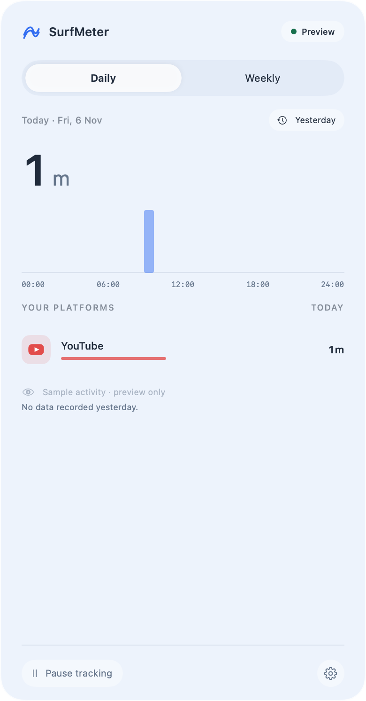
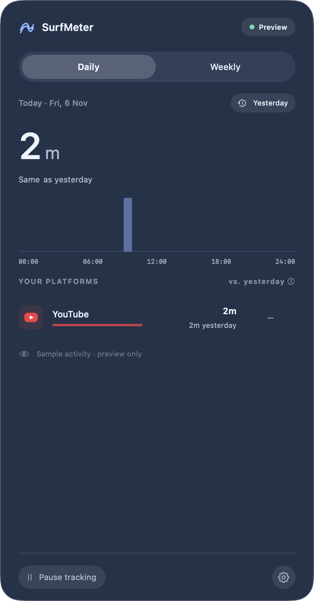
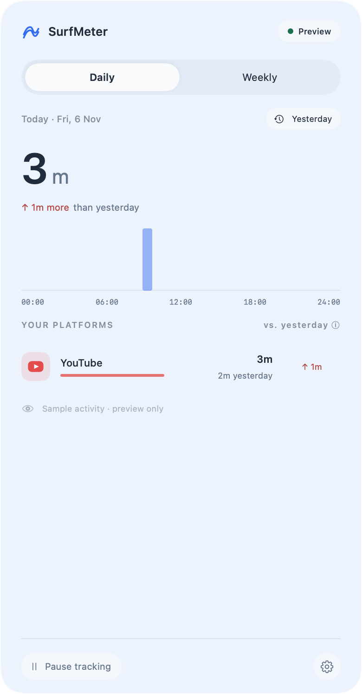
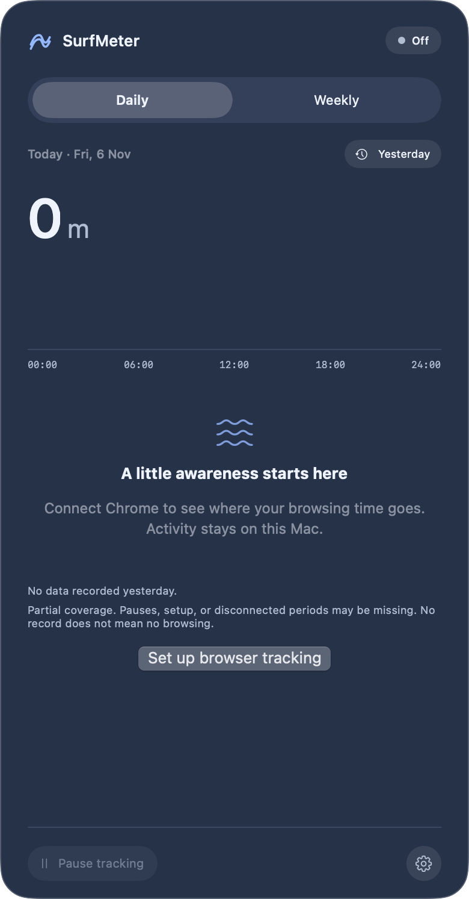

# Functional and visual audit — 2026-11-06

The automated development audit passes, and **41 assertions passed through the actual sample-data UI** in the isolated test workflow. The installed menu-panel check and real-browser/release matrix remain separate gates. This document does not certify every browser scenario or accessibility configuration.

Environment: Apple Silicon, macOS 27.2, Swift 6.4 Command Line Tools, Node 24.22.2. The baseline was commit `5b626d3`; this audit adds the fixes and repeatable checks below. Full Xcode and Safari packaging remain unavailable.

## Findings fixed

| Finding | Correction | Regression evidence |
| --- | --- | --- |
| A second instance could lose the socket race but still checkpoint stale store contents. | Acquire an exclusive, private writer lease before Core Data opens; reject duplicate instances with exit status 75. | New integration assertion reproduced the old bug (duplicate stayed running until the three-second timeout), then passed after the fix. Disposable crash/restart validation also checks lease release. |
| Shortening retention while idle pruned memory without marking the store dirty. | Pruning expired buckets or coverage now schedules a durable save immediately. | Model audit seeds 16 days, clears the dirty flag, changes 30 to 7 days, then opens a separate store and checks expired rows and coverage are gone. |
| Missing yesterday data could produce a comparison against assumed zero. | Comparisons require recorded coverage or existing totals. Setup/partial-only coverage does not establish a zero baseline. | Missing-yesterday fixture has partial-only coverage; its render shows today's time and the missing-data note without a delta. Known zero remains a separate fixture. |
| Bridge failure displayed a storage retry action. | The bridge banner now retries the connection; storage retains its separate retry action. | Wiring reviewed; normal bridge framing/reconnect/app-loss integration passes. Clicking retry after a real bridge failure remains pending. |
| Website details used a large total instead of the paired prototype statistics. | Restored domain identity, paired daily/weekly statistics, context labels, and exclusion explanation. | Actual Daily/Yesterday/Weekly detail interaction and Back-state checks pass. |
| Hourly accessibility labels repeated the chart title for each bar. | Contain the chart as a group and expose each hour with its own duration. Hide the decorative retention chevron from accessibility. | Native accessibility tree shows 24 distinct hour/duration entries. |
| Equal time read “Same than yesterday.” | Website details used a large total instead of the paired prototype statistics. | Restored domain identity, paired daily/weekly statistics, context labels, and exclusion explanation. | Actual Daily/Yesterday/Weekly detail interaction and Back-state checks pass. |
| Hourly accessibility labels repeated the chart title for each bar. | Contain the chart as a group and expose each hour with its own duration. Hide the decorative retention chevron from accessibility. | Native accessibility tree shows 24 distinct hour/duration entries. |
| Equal time reads “Same as yesterday,” with a neutral row indicator. | Equal light/dark render inspection. |
| Sub-second platform progress was capped against a one-second minimum. | Relative row bars use the actual peak, with a small numerical safety floor. | Sub-minute fixture inspection. |
| Disabled recording could still look ready to track. | Off/disconnected status is explicit; Off opens setup and the pause control is disabled while recording is off. | Genuine isolated first-run light/dark renders. |
| Weekly omitted weekday/date/Today labels and per-platform daily averages. | Restored these labels and averages, with a compact date range. | Weekly and weekly-detail renders compared with the reference. |
| Retention used a different visual control from the prototype. | A compact capsule menu now provides 7/30/90 days. Row comparison labels explicitly say yesterday. | Preferences and Daily renders inspected against the approved references. |

## Checks executed

| Area | Result and boundary |
| --- | --- |
| Core Swift tests | **21 pass**: privacy/framing, timing, switches, idle cutoff, stale snapshots, generation invalidation, exclusion boundaries, PSL/aliases, comparisons, hourly/midnight/DST boundaries, storage reopen/retention/deletion, and invalid storage location. Autumn clock fallback now explicitly verifies repeated 01:00 time shares one local bucket without losing seconds. |
| Chrome extension | **3 Node tests pass**, with strict TypeScript build. Includes hostname-only normalization, private/internal/file/malformed pages, event ordering, stale async queries, reconnect, and focus changes. Browser APIs are mocked. |
| App-model integration | **21 assertions pass** using a temporary SQLite directory and a unique preferences suite that is removed afterward. Includes restart restoration, today/yesterday/week/menu consistency, idle retention on disk, normalized/deduplicated exclusions, invalid input, pause/resume, durable deletion, preference preservation/reload, storage failure, and recovery. |
| Appearance | **6 transitions pass** in the same NSPanel: explicit Light/Dark against opposite simulated system themes, plus System under both themes. AppKit and SwiftUI agree; the Preferences route remains selected. This does not click the actual switch or change global macOS appearance. |
| Native bridge | **Pass** with actual app/helper/socket in temporary directories: framing, privacy checks, ordering, origin restriction, reconnect, app loss, and permissions. Synthetic hostnames only. |
| Recording through disk | **Pass**: actual app → helper → eligibility/accounting → SQLite, about 12 eligible synthetic seconds followed by 10 unavailable seconds. Only the eligible interval accumulates. Duplicate app launch is rejected before storage opens; a forced crash releases the lease, and the replacement restores durable totals and reconnects the existing helper without downtime backfill. The lease file is mode 0600. Native Chrome foreground is explicitly simulated. |
| Accelerated duration | **Pass**: 600 deterministic seconds across midnight, durable reopen, retention, deletion. This is not the real-browser ten-minute accuracy experiment. |
| Invalid installed-setup commands | **6 invalid cases rejected with status 64**. Saved preferences and Chrome host configuration/registration fingerprints remained unchanged. |
| Lock smoke check on installed app | **Pass for sampled interval**: aggregate seconds did not increase over 15 seconds; the native lock signal was locked at both endpoints. No browsing domains were printed or copied. Unlock/wake transitions remain untested. |
| Packaging | **Pass**: strict deep ad hoc signature check and development ZIP creation. This does not establish production signing/notarization. |
| Native UI interactions | **41 assertions pass** in the isolated sample window through native computer control. Includes periods, detail Back state, exclusions, actual Light/Dark/System controls, retention menu options, validation, Return submission, setup scrolling, recording off/on, pause/resume and Command-Shift-P, deletion Cancel/Confirm, and empty-state refresh. Quit was also exercised; the installed app remained running. |
| Native visual artifacts | **36 renders**: 16 standard light/dark panels, 2 full settings/setup content views, 16 comparison/empty fixtures, and 2 genuine isolated first-run panels. Critical comparison, first-run, Daily, detail, Weekly, and Preferences renders were inspected; renders do not prove pointer/keyboard behavior. |

## Visual comparison

Compared the native captures with `docs/media/daily-2x.png`, `preferences-dark-2x.png`, and `weekly-2x.png`, together with the prototype detail markup. The native implementation follows the 390-point panel width, rounded glass direction, system typography, split duration display, Daily/Weekly tabs, Yesterday shortcut, vector brand marks, colored progress bars, stacked comparisons, and compact footer/settings layout.

The prototype has a simulated wallpaper and browser connection, fixed dates, and illustrative zero-hour bar stubs. Native glass depends on the real desktop and system settings; empty hours remain genuinely empty. Native setup also exposes the real installation/permission steps and honestly reports Safari unavailable. Duration displays truncate whole minutes consistently; the illustrative prototype rounds some daily averages. These differences are deliberate. Live light/dark material and settings were inspected in the isolated native window; the actual switch updated the same window immediately. Exact wallpaper-dependent material pixels and the installed menu-panel placement are not certified by those captures.

| Missing baseline: no invented comparison | Equal totals: neutral comparison |
| --- | --- |
|  |  |

| More time: red plus arrow | Actual isolated first run: recording off |
| --- | --- |
|  |  |

All committed audit images contain synthetic activity or an empty isolated store. No screenshot of personal browsing or private activity is included.

## Interactive check results

Use `.build/SurfMeter.app/Contents/MacOS/SurfMeter --ui-audit` for sample-data interaction. This mode opens a labeled window, does not start the normal bridge, and never opens the normal activity store or preferences. Quit that audit process afterward.

| Sequence | Expected result | Current status |
| --- | --- | --- |
| Daily → Yesterday → Yesterday again | 3h 10m → 4h 2m → 3h 10m in the sample window. | **Pass** in isolated native UI. |
| Yesterday → Weekly → Daily | Seven-day view, then Daily opens today. | **Pass** in isolated native UI. |
| Open a platform from Daily/Yesterday/Weekly; go Back | Correct hourly/daily detail; Back preserves the selected period/date. | **Pass** in isolated native UI. |
| Preferences → Dark appearance off/on → Use system | The same open panel and native controls update immediately; navigation is preserved. | **Pass**: actual switch off/on and Use system; same-window light/dark screenshots inspected. |
| Retention menu → 7/30/90 days | Menu selection updates; retention persists. | **Pass**: all three actual menu choices; model suite separately verifies persistence. |
| Add valid/invalid domain, duplicate alias; remove chip | Correct normalization/error; no duplicated entry; removal works. | **Pass**: validation, normalization, removal, and Return submission; alias deduplication also passes the model suite. |
| Pause/resume from status and footer; keyboard shortcut | Controls stay consistent and no paused time accumulates. | **Pass**: footer Pause, status Resume, and Command-Shift-P twice. Eligibility exclusion passes core tests. |
| Delete activity → Cancel; then confirm in sample window | Cancel preserves totals; confirm clears them. Never run this on personal history for testing. | **Pass**: actual Cancel preserves 3h 10m; confirmation produces 0m and empty state. Durable deletion/reopen passes model checks. |
| Preferences → Connected browsers → Back; scroll setup | All setup controls reachable; Safari clearly unavailable. | **Pass**: actual route, Back, and scrolling to Safari status; recording toggle off/on and Pause disabled state checked. |
| Open/close the installed menu panel and change appearance | Correct screen placement and real material; no duplicate app or reset state. | **Tool blocked**: the menu-only panel was not exposed by the native automation service. No installed-panel placement pass is claimed. |
| Tab/Shift-Tab/Space/Enter, VoiceOver, contrast/transparency/motion settings | Controls reachable and correctly named; readable fallbacks. | **Partial**: Return submission, Command-Shift-P, and hour/duration accessibility entries pass. Full Tab order, spoken VoiceOver and system accessibility settings remain pending. |

Real-browser gates remain the ones in [Validation](validation.md): a controlled ten-minute accuracy session; real private/minimized/internal pages and multiple profiles/windows; permission loss; idle/sleep/unlock/recovery; login/reboot; performance; supported older OS/Intel; and Safari implementation. A green automated run does not close these gates.

## Reproduce

After installing extension dependencies with `cd extensions/chrome && npm ci`, run from the repository root:

```sh
./scripts/audit-native.sh
```

The script builds/tests the extension and native app, runs the isolated integration/model/theme checks, packages the ad hoc build, and writes standard/edge-case renders to a new temporary directory. Its final output gives the location. Inspect those images and perform the pending interaction table separately; the script does not declare a visual or real-browser pass automatically.

## Desktop and DMG — 2026-11-06, version 0.3.0

Added a retained AppKit desktop window hosting SwiftUI and Swift Charts. It shares the original model, writer lease, activity store and bridge with the menu panel; desktop navigation does not mutate the menu's screen. The menu footer includes an accessible Open detailed view button. First-run setup uses a separate completion key and never implicitly enables recording.

Verified in a sample-only native desktop session through macOS accessibility controls: Daily/Weekly selection, seven-day totals, website selection and chart filtering, unmatched website search, opening the walkthrough, all four walkthrough steps, final appearance selection, returning to the same desktop selection, opening Preferences, and switching from dark back to light. External installation/login controls were disabled in this audit; no real history was cleared or modified. Native 2× desktop and walkthrough screenshots in both appearances were visually reviewed.

The full local regression audit passed: 21 core tests, three extension tests, nine resource-tooling tests, app/helper protocol and reconnection checks, duplicate-writer protection, synthetic recording/durable reopen, 25 isolated model assertions (including four onboarding checks), six appearance transitions, and accelerated tracking verification. This is distinct from real-browser accuracy/privacy certification. Packaging creates a compressed DMG and checksum; its read-only mount inspection verifies the signature, bundle contents, offline guide and absence of local activity/configuration files. The optimized build was installed over the existing app; the installer verified unchanged preferences and preserved aggregate totals. The installed desktop showed Chrome connected, and closing/reopening the window and the Yesterday/Today shortcuts were checked. Gatekeeper/notarization and a separate clean Mac remain unverified release gates.

## Menu-panel corners — 2026-11-06, after Alpha 1

The menu panel clipped its SwiftUI contents to a rounded rectangle, but the native window retained an opaque rectangular backing. A user screenshot exposed square wedges outside the glass corners that content-only preview captures had not revealed.

`MenuPanelSurface` now clears the window container on macOS 15+, clears the AppKit window backing (including the macOS 14 path), and masks the content layer to the same 26-point continuous corners as the SwiftUI fill and border. The modifier is attached only to the menu dashboard. Shadow invalidation runs only when surface properties change, rather than on every activity tick.

The existing appearance verification now asserts native transparency, layer masking, radius and corner curve across six light/dark/system transitions. An additional check confirms the desktop keeps its native window backing. Sample previews were rendered again and the installed app was updated with unchanged preferences and preserved aggregate totals. The actual macOS 14 fallback still requires a supported-OS test. This fix is committed after the original Alpha 1 tag; the published Alpha 1 assets remain unchanged.


## Website brand icons — 2026-11-06, after Alpha 1

Replaced the five illustrative native brand drawings and generic brand symbols with bundled upstream vector artwork for 48 website identities / 67 domain aliases, including ChatGPT, Google, the social platforms, developer tools, streaming and productivity sites. The menu panel, desktop, detail headings and accessibility labels use consistent display names; unknown sites receive initials. No icon lookup sends browsing domains off the Mac, and neither accounting classification nor existing totals change.

The isolated `--verify-site-icons` check validates every bundled vector's geometry, required familiar sites, unique aliases, subdomain normalization, more-specific service matching, deceptive suffix rejection, fallback initials and unchanged accounting grouping. The light/dark 2× galleries were rendered and reviewed. Artwork is decoded and converted to paths once per process; no image request or repeated SVG parsing occurs during recording. The app build and DMG verifier now check the app's additional resource bundle and retained licenses. Published Alpha 1 assets remain unchanged.


## Complete native-frame follow-up — 2026-11-06

The user supplied a second screenshot showing native window decoration still outside the custom corners. This supersedes the earlier content-backing fix: clearing and clipping the content did not remove the system MenuBarExtra frame.

Replaced that container with an AppKit status item and an owned transparent borderless panel. The retained SwiftUI hosting tree preserves menu navigation; intrinsic sizing updates the native window for each page. Placement clamps to the status item's display, including short screens and monitors with negative/stacked coordinates. Escape, outside clicks and application deactivation dismiss it; expanding to the desktop closes the menu. Tracking still uses the original shared model, bridge and store.

`--verify-menu-panel` captures the **entire native frame view**, checks eight corner pixels per screen for transparency, verifies visible interior pixels and zero outer padding, and exercises daily/preferences/setup in both appearances. It also checks 20 display/height combinations, live intrinsic sizing and a 540-point height limit. The light/dark native-frame images were visually reviewed. Native automation could not attach to the floating audit panel; this limitation is not counted as a successful click-through. Status-click toggling, outside-click/Escape interaction and full-screen/Space behavior still need a live interaction check. The published Alpha 1 artifacts remain unchanged.


Frame evidence: [daily light](media/audit/native-frame/menu-frame-daily-light-2x.png) · [daily dark](media/audit/native-frame/menu-frame-daily-dark-2x.png). These are full native-frame renders with sample activity. The complete local regression audit passed after the replacement, followed by the optimized native-frame audit and an installed-app update that verified unchanged preferences and preserved aggregate totals.


## Single-click period controls — 2026-11-06

The user reported having to click Daily/Weekly repeatedly. The plain unselected button had no explicit hit shape across its expanded label. Added a full rectangular hit target inside each segment label. Yesterday's capsule padding/background now belong to the button label too, with a capsule hit shape. The menu hosting view explicitly accepts first mouse events, and opening activates the app before making the panel key.

Verified through native UI controls in a sample-only audit app with a separate bundle identity: eight individual coordinate clicks switched Daily/Weekly on the first click, covering left/right segment edges and top/bottom padding away from the text. Two additional padded-area clicks toggled Yesterday on and off, each with one click. Selection and totals were read after each action. The window-frame audit also verifies the hosting view's first-mouse policy; inactive-app click-through in the actual floating panel remains a separate live acceptance check.

## Stable Daily/Weekly window — 2026-11-06

The user reported the menu snapping when changing periods. Daily requested 746 points and Weekly 766 points, causing the hosting view to resize and reposition the native window after each selection. Both now use one 766-point activity height, capped to the available display space. The controller's initial size and preview/audit dimensions use the same value. Chart and row changes stay inside the existing scroll area; preferences/setup/detail navigation retains its separate sizing.

The native frame audit measures both actual Daily and Weekly SwiftUI trees and verifies identical fitting sizes and native positions at normal height and a 540-point screen limit. Full-frame transparency/layout checks and appearance transitions passed. The optimized app was installed with preferences unchanged and aggregate totals preserved.


## Desktop Liquid Glass controls — 2026-11-06

Replaced the standalone window's standard rectangular segmented picker and date field with a capsule period switcher, native glass action buttons, a localized date button opening a graphical calendar, and a glass search field with clear and focus affordances. macOS 26+ uses SwiftUI `glassEffect`, `GlassButtonStyle` and `GlassProminentButtonStyle`; older versions use capsule/material or bordered fallbacks. Custom glass surfaces use an opaque fallback for reduced transparency or increased contrast. The desktop hosting view accepts first mouse events so the custom controls do not require an extra activation click.

In a uniquely identified sample-only native desktop, verified Daily/Weekly switching, opening the calendar, selecting a different date through the native date control and seeing totals change, Done dismissal, Today/Yesterday shortcuts, search filtering/clear, and appearance switching. Live native glass was visually inspected in light and dark appearances; final labels received explicit contrast colors. Offscreen AppKit bitmap previews omit parts of the live glass compositor and are not used as proof of its final appearance. The later light-view recheck was interrupted by user control; it is not counted as an additional completed interaction test. Older-macOS fallback and accessibility settings still need checks on their corresponding systems.

## Liquid Glass sidebar — 2026-11-06

The desktop sidebar now uses a native glass surface over an explicit AppKit behind-window sidebar backdrop. Its previous blur sat over the app's opaque blue root background. The window backing is now clear and non-opaque, and the solid activity background is scoped to the main content area. A rounded inset glass edge, capsule selection, accent-colored selected labels, hover feedback and full navigation hit targets match the desktop controls. Reduced-transparency/increased-contrast modes use an opaque sidebar fallback; older macOS versions retain a material fallback.

Inspected the live sample-only desktop in light and dark appearances and verified Activity, Browser setup and Preferences navigation before and after refining the backdrop. Existing appearance checks now verify the desktop's clear backing while preserving independent menu corner policy. Native menu-frame/size checks pass. Live effects depend on the desktop content behind the window; offscreen bitmap renders are not treated as evidence of backdrop blur.

## macOS system colors — 2026-11-06

Replaced the custom blue-gray surface palette with AppKit semantic colors: window background, labels, secondary labels, separators, neutral control/selection fills and the user's control accent. Removed the desktop's blue gradient and the menu period track's blue tint. Onboarding and icon preview backgrounds use the same native window color. Glass and behind-window sidebar materials remain adaptive to their surroundings.

Reviewed native layout renders in both appearances: dark surfaces are neutral macOS grays and light surfaces use the native light window color. Preview windows now set their AppKit appearance explicitly, keeping semantic-color captures consistent with their requested mode. Explicit Light/Dark and System appearance checks and native menu-frame checks pass. Static renders continue to omit portions of the live glass compositor, so their background colors are reviewed separately from the previously verified live glass effects.
