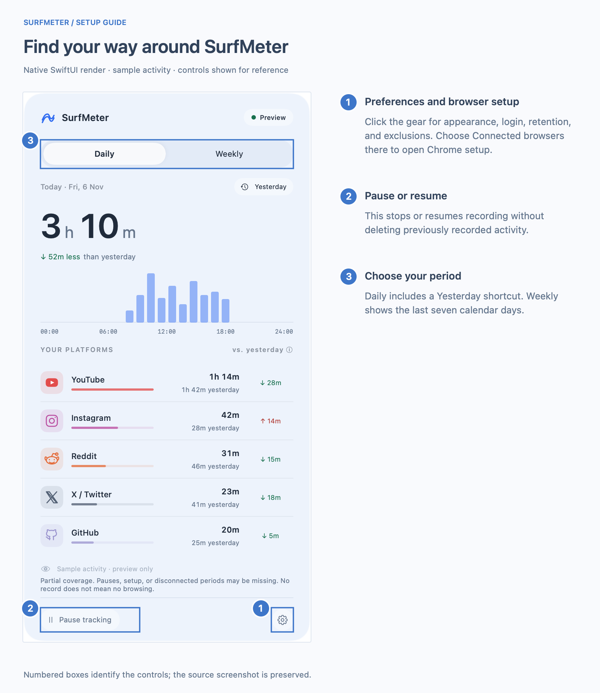
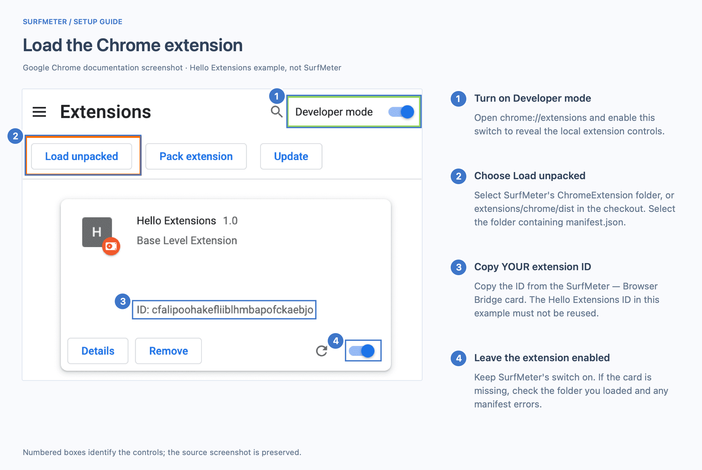
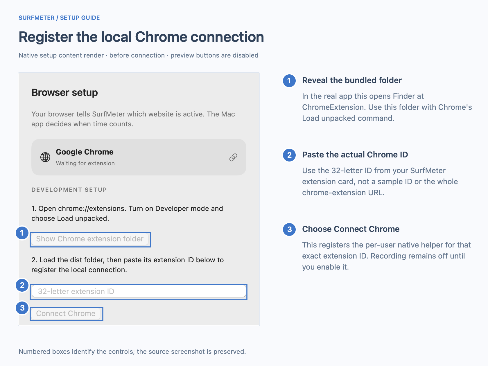
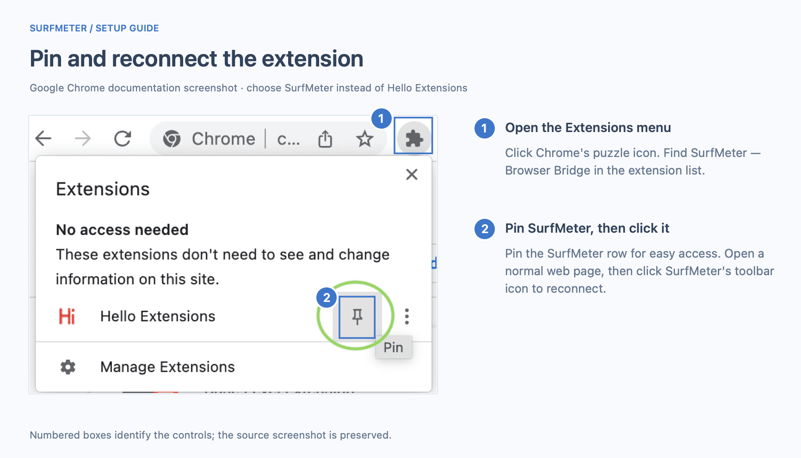
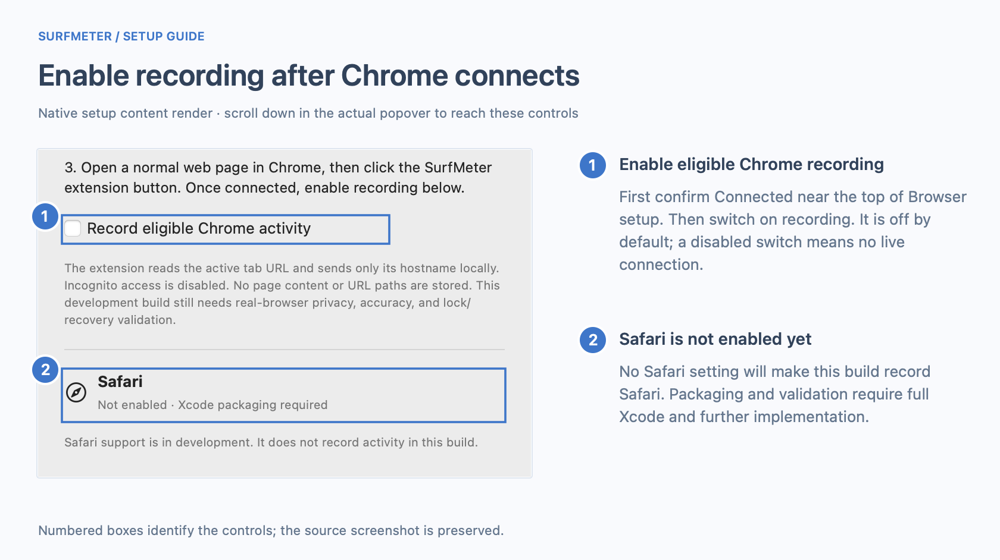
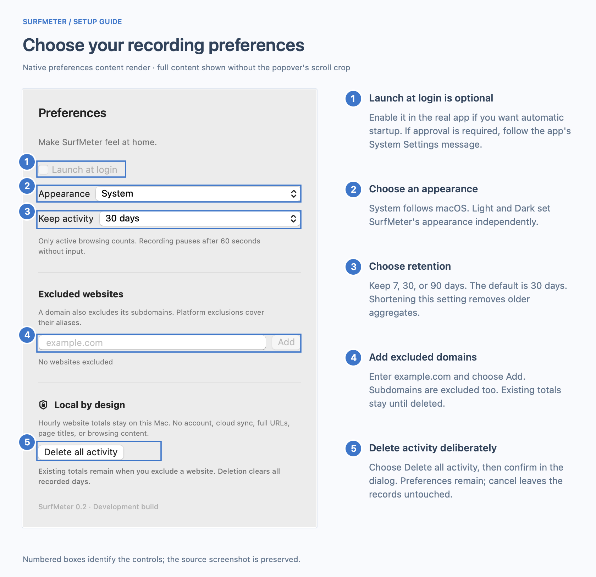
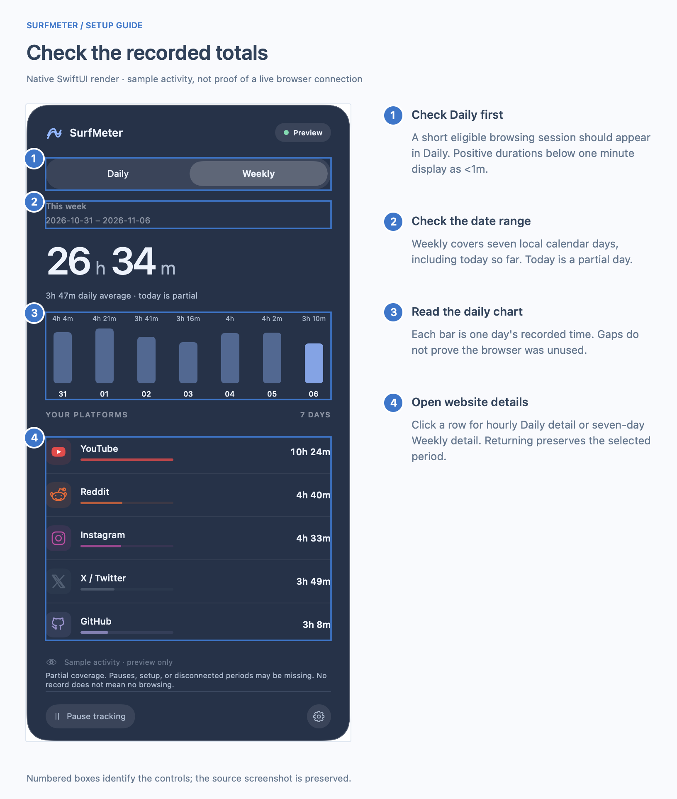
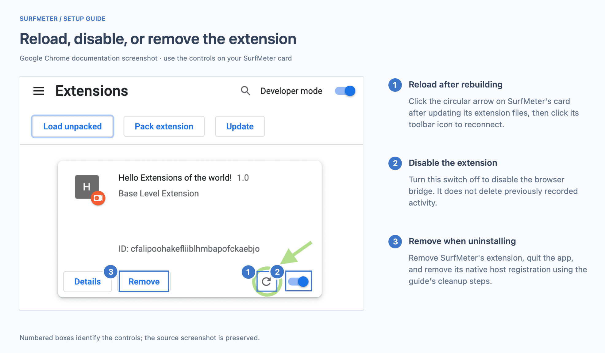

# Set up SurfMeter on your Mac

This guide takes you from a checkout to recorded Chrome activity, then covers preferences, troubleshooting, updates, and removal.

**Current build:** SurfMeter 0.2 development build. Chrome is the implemented adapter; Safari is not enabled. The deployment target is macOS 14+, but only Apple Silicon/macOS 27.2 has been exercised. Browser privacy/accuracy certification and signed, notarized distribution are still pending. See [validation](validation.md).

The annotated images use native SurfMeter UI renders and Google's official Chrome example screenshots. SurfMeter renders use sample data or the pre-connection state; greyed-out preview buttons are enabled in the real app. Google's screenshots show **Hello Extensions**, so use your **SurfMeter — Browser Bridge** card and its actual ID instead. Images are available as 2× PNGs and [editable annotation data with SVG exports](media/setup/README.md). Click any image to zoom.

[Build and open](#1-build-and-open-the-app) · [Find setup](#2-open-browser-setup) · [Load Chrome](#3-load-the-chrome-extension) · [Connect](#4-register-the-local-connection) · [Pin](#5-pin-and-reconnect-the-extension) · [Record](#6-enable-recording) · [Preferences](#7-choose-your-preferences) · [Check results](#8-check-that-activity-is-being-recorded) · [Troubleshoot](#troubleshooting) · [Remove](#remove-surfmeter)

## 1. Build and open the app

### Prerequisites

| Item | Needed for |
| --- | --- |
| A Mac and Google Chrome | Running the development app and browser integration. Use one Chrome profile for initial setup. |
| Swift 6 toolchain and macOS SDK | Compiling the native app. Install current compatible Command Line Tools or Xcode through [Apple's developer resources](https://developer.apple.com/xcode/resources/). |
| Node.js with npm | Building the extension. Use an LTS installer from the [official Node.js download page](https://nodejs.org/en/download). |
| Git | Getting the repository; included with Apple's command line tools. |
| Python 3 | Optional native verification scripts and the alternative CLI host installer. The normal GUI connection flow does not require Python. |

Check the tools in Terminal:

```sh
xcode-select -p
swift --version
node --version
npm --version
```

If Apple's command line tools are missing, start their installer and finish the macOS prompts:

```sh
xcode-select --install
```

Confirm `swift --version` reports Swift 6 or later. If Node/npm was just installed, open a new Terminal window before checking again. No Apple Developer Program membership is needed for this local ad hoc build; a distributable signed/notarized release is a separate milestone.

### Build from a checkout

For a new checkout:

```sh
git clone https://github.com/vishwajayawickrama/surf-meter.git
cd surf-meter
```

If you already have the repository, open Terminal in that checkout instead. From its root:

```sh
cd extensions/chrome
npm ci
npm run build
cd ../..
./scripts/build-native.sh
open .build/SurfMeter.app
```

**Expected:** the extension builds into `extensions/chrome/dist`, the app is created at `.build/SurfMeter.app`, and a waves icon with a time label appears in your Mac's menu bar. SurfMeter is a menu bar app, so no main window or Dock icon is required. On a fresh setup, recording starts off; existing preferences are retained.

Keep the app in its current location while iterating. If you prefer another location, move/copy it there **before loading its bundled extension and connecting Chrome**, then open that copy. The helper records the app's location. The figures below show the popover, not the surrounding Mac menu bar.

### If you already have a development archive

An archive created by `./scripts/package-app.sh` contains `SurfMeter.app`, its helper, and the compiled Chrome extension. Extract it, choose the app's final location, and open it; you can skip the build-tool steps. There is no claimed notarized public release yet. If macOS blocks an app, verify its source and consult [Apple's guidance for opening apps from an unknown developer](https://support.apple.com/guide/mac-help/open-a-mac-app-from-an-unknown-developer-mh40616/mac) rather than disabling system protections.

## 2. Open Browser setup

Click SurfMeter's waves/time item in the menu bar, then click the **gear** in the popover footer and choose **Connected browsers**. Choose **Show Chrome extension folder** in Browser setup. Finder reveals the app's bundled `ChromeExtension` folder.

[](media/setup/01-open-surfmeter@2x.png)

**Expected:** the setup screen initially says **Waiting for extension**. If your dashboard has no rows, that is normal; the figure uses labeled sample activity. You can still use the same footer controls.

## 3. Load the Chrome extension

In Chrome, type `chrome://extensions` in the address bar. Enable **Developer mode**, choose **Load unpacked**, and select the `ChromeExtension` folder revealed by SurfMeter. This is the standard local-extension workflow described in [Chrome's official tutorial](https://developer.chrome.com/docs/extensions/get-started/tutorial/hello-world#load-unpacked).

For repository-based extension development, you may instead select `extensions/chrome/dist`. In either case, select the **folder containing `manifest.json`**, not the JSON file, the app bundle, the repository root, or `extensions/chrome/src`. The app's setup copy currently calls the folder `dist`; the bundled copy exposed by Finder is named `ChromeExtension`. They contain the same compiled extension files.

[](media/setup/02-load-chrome@2x.png)

**Expected:** a card named **SurfMeter — Browser Bridge** appears and its enabled switch is on. Copy its **32-letter extension ID**. The example ID pictured above belongs to Google's tutorial and will not connect your SurfMeter build.

### Access used by this build

| Access | Purpose |
| --- | --- |
| `tabs` | Read the selected tab URL, then reduce it to a hostname before native messaging. |
| `nativeMessaging` | Send the hostname/state to SurfMeter's local helper. |
| `alarms` | Retry the browser connection after worker suspension. |
| Incognito | Disabled by the extension manifest. Do not try to enable private-window recording. |
| Login item | Optional, configured separately in Preferences. |

Chrome may describe these capabilities as **“Read your browsing history”** (`tabs`) and **“Communicate with cooperating native applications”** (`nativeMessaging`). These are broad API permission warnings; SurfMeter's current code reads selected-tab state and does not use Chrome's history API. See [Chrome's official permission descriptions](https://developer.chrome.com/docs/extensions/reference/permissions-list).

No account or backend is involved. These setup steps do not request Full Disk Access, Accessibility access, or screen recording. Real private-window/focus/permission behavior still needs release validation; see [the acceptance record](validation.md).

## 4. Register the local connection

Return to SurfMeter → **Browser setup**. Paste your actual ID into **32-letter extension ID**, then choose **Connect Chrome**. Scroll the setup panel if the field/button is below the visible area.

[](media/setup/03-register-chrome@2x.png)

**Expected:** a registration-success message asks you to open a normal page and click the extension button. Registration is only the local helper setup; it does not yet prove a live browser connection or enable recording.

The GUI installs only the per-user SurfMeter files:

```text
~/Library/Application Support/SurfMeter/NativeHost/SurfMeterNativeHost
~/Library/Application Support/SurfMeter/NativeHost/host-config.json
~/Library/Application Support/Google/Chrome/NativeMessagingHosts/dev.surfmeter.bridge.json
```

The registration permits only your specified extension origin; it does not use wildcard origins or administrator access. If an existing different registration is found, SurfMeter leaves it intact and reports a failure. See [existing registration](#existing-registration-or-changed-extension-id) below.

## 5. Pin and reconnect the extension

Open Chrome's **Extensions** puzzle menu, find **SurfMeter — Browser Bridge**, and pin it. Open a normal `http` or `https` web page, then click SurfMeter's toolbar icon. Pinning is optional, but makes reconnecting easier. The control positions are illustrated in [Chrome's pinning tutorial](https://developer.chrome.com/docs/extensions/get-started/tutorial/hello-world#pin-the-extension).

[](media/setup/04-pin-chrome@2x.png)

**Expected:** SurfMeter's Browser setup screen changes to **Connected** while fresh messages arrive. A successful bridge acknowledgement clears the extension's `!` badge. Its generic toolbar icon is expected in this development build.

The toolbar action starts a fresh native connection. A newly started helper can reopen its configured SurfMeter app; an already-connected helper does not immediately reopen it after you choose Quit. If recovery fails, open SurfMeter manually and click the extension button again. Actual Chrome relaunch/recovery timing remains to be certified.

## 6. Enable recording

In SurfMeter → **Browser setup**, first check **Connected** near the top. Scroll down and turn on **Record eligible Chrome activity**. A disabled toggle means SurfMeter has not received a live connection; finish the prior steps first.

[](media/setup/05-enable-recording@2x.png)

**Expected:** recording is enabled in preferences. **Tracking** appears only while the current native/browser eligibility conditions are met; being connected alone is not enough.

Time can count when Chrome is foreground, its focused selected tab is eligible, the connection is fresh, you are within the 60-second input threshold, and recording is enabled/unpaused. Background tabs, unsupported/internal pages, exclusions, unavailable snapshots, and system-inactive intervals do not qualify. The initial 60 seconds without input count; later idle time does not get backfilled. Native lock/session behavior still needs manual validation.

Safari's **Not enabled** label is intentional. Installing Xcode alone does not add Safari tracking: the extension package, sandbox-safe adapter, and validation remain unfinished. See [Safari prerequisites](../extensions/safari/README.md).

## 7. Choose your preferences

Return to the dashboard or click the **gear** in the footer. Scroll Preferences to reach all controls.

[](media/setup/06-preferences@2x.png)

| Control | What to do | Expected behavior |
| --- | --- | --- |
| Launch at login | Optionally enable it. | SurfMeter uses the macOS login-item service. If it requests approval, follow the message to System Settings → Login Items. This development build may report signing/location errors; check the message rather than assuming registration worked. |
| Appearance | Toggle **Dark appearance** on for Dark, off for Light, or choose **Use system**. | System follows macOS; explicit choices apply immediately to SurfMeter’s open panel. |
| Keep activity | Choose 7, 30, or 90 days. | Default is 30 days. Shortening retention removes older aggregates; it cannot restore already-expired records. |
| Excluded websites | Enter a domain such as `example.com` and choose Add. | Future matching domain/subdomain activity is excluded. Recognized platform aliases are grouped. Existing totals remain. Use the row's × control to remove an exclusion. |
| Delete all activity | Choose the button, then confirm in the dialog. | Stored activity is cleared; preferences remain. Cancel keeps the records. If recording remains enabled, new activity can accumulate afterward. |

Use **Pause tracking** in the footer for a temporary stop. Use **Resume tracking** to continue; pause does not delete totals. Choose **Quit SurfMeter** at the bottom of Preferences, or in the gear’s context menu. Launch-at-login is opt-in and has not yet been certified on a signed clean installation.

## 8. Check that activity is being recorded

1. Confirm that **Record eligible Chrome activity** is on and **Pause tracking** is not active.
2. Keep an eligible normal Chrome page foreground and interact with it for 20–30 seconds. Avoid internal pages such as `chrome://extensions` for this check.
3. Open SurfMeter's **Daily** tab. Positive recorded time below one minute displays as **<1m**; **0m** means no positive recorded duration for that selection.
4. Switch to another full app or a browser-internal page, then return and check that the old site has not continued accumulating throughout that interval.
5. Try **Yesterday**, switch to **Weekly**, and open a website row. The menu bar label continues to represent today, whichever period the panel shows.

[](media/setup/07-check-dashboard@2x.png)

**Expected:** rows and totals reflect recorded activity. Daily compares today so far with yesterday's complete day: green/↓ means less, red/↑ means more, and equal values are neutral. A first run can show **No data recorded yesterday**. Missing records or partial coverage are not proof that the browser was unused.

This is a functional setup check, not the controlled ten-minute accuracy/private-window acceptance experiment. Record formal browser/OS checks in [Validation](validation.md) before advertising the integration as release-certified.

## Troubleshooting

| What you see | Check / recovery |
| --- | --- |
| No waves/time item | Open the app, not the prototype website. Check the right side of the menu bar; SurfMeter does not require a Dock window. Close other SurfMeter development instances if the bridge reports a conflict. |
| `npm: command not found` | Install Node.js with npm, reopen Terminal, and check `node --version` / `npm --version`. |
| Swift/package build fails | Check Swift 6 and the selected developer directory. Keep the first error output. Use the current build script and [development notes](development.md); installing only an old toolchain is insufficient. |
| Finder cannot reveal the extension | Rebuild the extension first, then the app. The bundle must contain `Contents/Resources/ChromeExtension/manifest.json`. |
| Chrome cannot load the folder | Select `ChromeExtension` or the built `extensions/chrome/dist` containing `manifest.json`. Do not select a source directory or file. Review Chrome's displayed manifest error. |
| ID rejected | Copy only the actual 32 lowercase letters from the SurfMeter card. Do not paste the sample screenshot's ID or a `chrome-extension://.../` URL. |
| Connect Chrome reports an existing registration | Use the inspection/replacement procedure below. GUI and CLI registrations use different helper locations. |
| Still Waiting / extension has `!` | Open SurfMeter, check the extension is enabled, use the same Chrome profile and ID, then click its toolbar icon. Reconnect after moving the app or loading a different extension folder. |
| Recording toggle disabled | Complete a live connection first. Registering the helper alone does not make the browser connected. |
| Connected, but time stays at 0m | Enable recording, resume if paused, focus a normal Chrome page, interact within the idle threshold, and check exclusions. Ignore Preview data when checking actual recording. |
| Bridge unavailable | Quit duplicate SurfMeter instances, then reopen one app and reconnect Chrome. A process-held lock prevents two app instances from sharing the same endpoint. |
| Save/storage error | Stop and read the banner. Check disk space/access, then use **Retry saving**. Unsaved totals stay in memory while recording is stopped; avoid quitting until a save succeeds if you want to preserve them. |
| Login item fails | Check the in-app message, the app's location, and macOS Login Items approval. Production signing and clean-install validation remain pending. |
| Safari remains unavailable | Expected in this build. There is no completed Safari setup path yet. |

### Existing registration or changed extension ID

Inspect the SurfMeter registration in Terminal before replacing it:

```sh
cat "$HOME/Library/Application Support/Google/Chrome/NativeMessagingHosts/dev.surfmeter.bridge.json"
```

Check its `path` and `allowed_origins` against the app/profile you intend to use. If it is an old SurfMeter development registration you want to replace, quit SurfMeter, remove **only that registration**, reopen the chosen app, and repeat Connect Chrome with its actual extension ID:

```sh
rm "$HOME/Library/Application Support/Google/Chrome/NativeMessagingHosts/dev.surfmeter.bridge.json"
```

This removes a bridge registration, not recorded activity. Do not remove unrelated browser host files. Re-run setup after moving the app, changing the loaded extension folder, or switching Chrome profiles; an extension ID may differ.

### Reload after updating

After updating sources, rebuild the extension and app using step 1. At `chrome://extensions`, click the circular **Reload** arrow on the SurfMeter card, then its toolbar icon to reconnect. Re-run Connect Chrome if the app location or extension ID changed. Google's [reload documentation](https://developer.chrome.com/docs/extensions/get-started/tutorial/hello-world#reload-the-extension) shows the control.

[](media/setup/08-reload-remove@2x.png)

## Optional command-line connection setup

The GUI path above is recommended. For development automation, from the checkout root:

```sh
python3 scripts/prepare-chrome-host.py --extension-id YOUR_32_LETTER_EXTENSION_ID
```

Inspect the generated `.build/chrome-native-host/dev.surfmeter.bridge.json`, then register it:

```sh
python3 scripts/prepare-chrome-host.py --extension-id YOUR_32_LETTER_EXTENSION_ID --install
```

Replace the placeholder with the actual Chrome ID. This alternative uses the helper in the checkout's `.build/chrome-native-host` directory, so keep that checkout in place. Do not alternate GUI and CLI installers without inspecting/removing a conflicting old registration. Neither installer enables recording automatically.

### Installed-app setup command

If the menu-only controls are difficult to automate, the installed app also supports this explicit command after you have loaded and approved its Chrome extension:

```sh
/Applications/SurfMeter.app/Contents/MacOS/SurfMeter --configure-chrome YOUR_32_LETTER_EXTENSION_ID --enable-recording --enable-login
```

Replace the placeholder with the ID shown on your SurfMeter card. The two enable flags are optional: recording is enabled/unpaused only when `--enable-recording` is present, and login registration is attempted only when `--enable-login` is present. Other preferences are retained. A running app is notified to reload the change. Exit code 3 means login is not yet enabled; follow the reported macOS approval/signing message. This command does not load an extension or bypass Chrome/macOS permission prompts.

## Where your data lives

| Location | Contents |
| --- | --- |
| `~/Library/Application Support/SurfMeter/Data/activity.sqlite` and SQLite sidecars | Local hourly per-platform aggregates and daily coverage metadata. |
| macOS UserDefaults for `dev.surfmeter.app` | Pause, recording enablement, exclusions, appearance, and retention preferences. |
| `~/Library/Application Support/SurfMeter/NativeHost` | GUI-installed native helper and its configuration. |
| `~/Library/Application Support/Google/Chrome/NativeMessagingHosts/dev.surfmeter.bridge.json` | Per-user Chrome registration. |

There is no cloud sync or account. Full URLs, paths, queries, titles, and page content are excluded from persisted activity. Use the confirmed in-app deletion control to clear recorded activity; removing the application alone leaves local records/settings.

## Remove SurfMeter

1. If you want recorded totals cleared, open Preferences → **Delete all activity** and confirm. For a clean stop, disable recording or pause before deletion so new activity does not immediately reappear.
2. Disable **Launch at login** if it is enabled. If necessary, remove SurfMeter from macOS Login Items.
3. Quit SurfMeter from Preferences or the gear’s context menu.
4. At `chrome://extensions`, choose **Remove** on **SurfMeter — Browser Bridge** and confirm Chrome's removal prompt.
5. Remove the single native host registration using the `rm` command in the existing-registration section. This does not delete your activity database.
6. Remove the app. The inactive helper directory and settings may remain locally; the locations table above identifies them. Avoid deleting the whole SurfMeter support directory if you intend to keep its activity data.

The Remove/toggle controls are shown in the last annotated figure. No Safari extension needs removal from this build.

## More detail and image sources

[Developer commands](development.md) · [Validation status](validation.md) · [Implementation tracker](implementation.md) · [Architecture](architecture.md) · [Image sources, attribution, and regeneration](media/setup/README.md)
